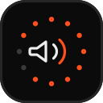

<div align="center">
  
  <h1>AudioCycle</h1>
  <p><b>Zero-clutter floating Windows audio output &amp; microphone switcher powered by Tauri 2, Rust CoreAudio (WASAPI), and React.</b></p>

  <p>
    <a href="https://github.com/supta69k/AudioCycle/actions/workflows/ci.yml">
      
    </a>
    <a href="https://github.com/supta69k/AudioCycle/releases">
      
    </a>
    <a href="LICENSE">
      
    </a>
    
    <a href="https://github.com/supta69k/AudioCycle/stargazers">
      
    </a>
  </p>
</div>

---

## Why AudioCycle?

Switching between headphones, speakers, monitors, and USB mics on Windows normally takes multiple taskbar clicks. **AudioCycle** stays docked cleanly at the edge of your display with near-zero idle footprint and lets the surrounding transparent overlay pass every click straight through to apps underneath.

- **Exact Geometric Click-Through** — Custom Win32 cursor hit-testing (`Circle` / `RoundRect` / `Rect`) keeps `WS_EX_TRANSPARENT` active around the floating pod so surrounding pixels never block clicks in games, browsers, or creative tools while preserving shadows and smooth hover transitions.
- **Persistent Topmost Overlay (`HWND_TOPMOST`)** — Automatically defends overlay ordering, `WS_EX_TOOLWINDOW` Alt+Tab hiding, and logical DPI bounds across multi-monitor transitions.
- **Event-Driven WASAPI Core** — Uses Windows `IMMNotificationClient` callbacks and thread-local cached COM interfaces (`IAudioEndpointVolume` & `IAudioMeterInformation`) with `0%` idle background device polling.
- **1-Click Multi-Role Switching** — Updates Windows **Console**, **Multimedia**, and **Communications** default roles in lockstep when switching speakers or microphones.
- **Instrument-Panel Controls** — Features a 36-dot radial level ring, a 32-cell fast-attack / smooth-release stereo VU meter, per-device skip/include rotation toggles, and compact customization (`Round` / `Soft` / `Square`, accents, edge snap, idle tuck).

---

## Controls & Shortcuts

| Input | Action |
| :--- | :--- |
| **Left Click (pod)** | Unmute if muted, otherwise cycle active devices (configurable) |
| **Middle Click (single)** | Toggle **Volume Mode** (shows `VOL` readout; `Esc` to exit) |
| **Mouse Wheel** | Adjust volume `±4%` per notch while **Volume Mode** is active |
| **Middle Click (double)** | Mute / unmute active device |
| **Right Click (pod)** | Open Studio Panel (or flip `OUT`/`IN` / hide pod) |
| `Alt + Shift + C` | Global shortcut: cycle active output or input device |
| `Alt + Shift + A` | Global shortcut: show / hide floating pod |
| `Alt + Shift + S` | Global shortcut: open / close Studio Panel |

---

## Installation

### End Users (Windows 10 / 11)
1. Download the latest `.msi` or `-setup.exe` installer from [GitHub Releases](https://github.com/supta69k/AudioCycle/releases).
2. Run the installer — WebView2 Runtime is already included on Windows 11 and modern Windows 10 systems.

### Headless CLI & Stream Deck / Macro Integration
AudioCycle enforces a named single-instance lock (`AudioCycle.SingleInstance`). Launching CLI commands signals switching cleanly without spawning duplicate tray or window instances:

```powershell
AudioCycle.exe --cycle-output
AudioCycle.exe --cycle-input
AudioCycle.exe --version
```

---

## Project Architecture

```text
AudioCycle/
├── .github/
│   ├── ISSUE_TEMPLATE/             # Structured bug & feature YAML forms
│   ├── workflows/
│   │   ├── ci.yml                  # TypeScript check, Vite build & Cargo tests on main/PRs
│   │   └── release.yml             # Tag-driven Windows installer releases
│   └── PULL_REQUEST_TEMPLATE.md
├── assets/
│   └── logo.svg                    # Vector mark matching the instrument-panel design system
├── src/                            # React + TypeScript UI
│   ├── components/
│   │   ├── ControlPanel.tsx        # Device routing, stereo VU telemetry & settings view
│   │   └── Primitives.tsx          # Memoized DotRing, LevelMeter, Segmented & Toggle primitives
│   ├── constants/config.ts         # Window geometry, storage keys & theme tokens
│   ├── types/audio.ts              # Shared domain & Tauri IPC contracts
│   ├── utils/
│   │   ├── display.ts              # Multi-monitor clamping, DPI helpers & edge docking
│   │   ├── hitRegions.ts           # Exact geometric hit-region builder for click-through
│   │   └── sound.ts                # Subtle Web Audio tactile feedback tones
│   ├── App.tsx                     # Pod orchestration, hotkey events & telemetry loop
│   └── styles.css                  # Minimalist instrument-panel CSS design tokens
└── src-tauri/                      # Rust + Tauri v2 Native Backend
    ├── src/
    │   ├── audio/
    │   │   ├── mod.rs              # Cross-platform audio facade & shared telemetry types
    │   │   └── windows.rs          # Native WASAPI COM endpoint switcher & IMMNotificationClient
    │   ├── commands.rs             # Tauri IPC handlers
    │   ├── instance.rs             # Single-instance mutex & named wake event listener
    │   ├── overlay.rs              # Win32 cursor hit-test controller & HWND_TOPMOST guard
    │   ├── tray.rs                 # System tray icon menu & global shortcut registration
    │   ├── lib.rs                  # App setup, CLI handler & plugin wiring
    │   └── main.rs                 # Binary entry point
    ├── tauri.conf.json             # Standard Windows desktop bundle configuration
    └── tauri.microsoftstore.conf.json # Offline WebView2 bundle config for Microsoft Store
```

---

## Development & Building

### Prerequisites
- **Node.js** 20+
- **Rust** stable toolchain (`rustup`) with Visual Studio C++ Build Tools (MSVC + Windows SDK)

### Commands

```powershell
# Install dependencies
npm install

# Run desktop app in hot-reload dev mode
npm run tauri:dev

# Run checks & unit tests
npm run typecheck
npm run build
cargo test --manifest-path src-tauri/Cargo.toml

# Build production executable & Windows installers (.msi / -setup.exe)
npm run tauri:build

# Build offline WebView2 bundle for Microsoft Store
npm run tauri:build:store
```

---

## Contributing & Changelog

- See [CONTRIBUTING.md](CONTRIBUTING.md) for development guidelines and commit conventions.
- See [CHANGELOG.md](CHANGELOG.md) for release notes and engineering improvements.
- Governed by our [Code of Conduct](CODE_OF_CONDUCT.md).

## License

Licensed under the [MIT License](LICENSE). Copyright © 2026 [Supta Baul](https://github.com/supta69k).
